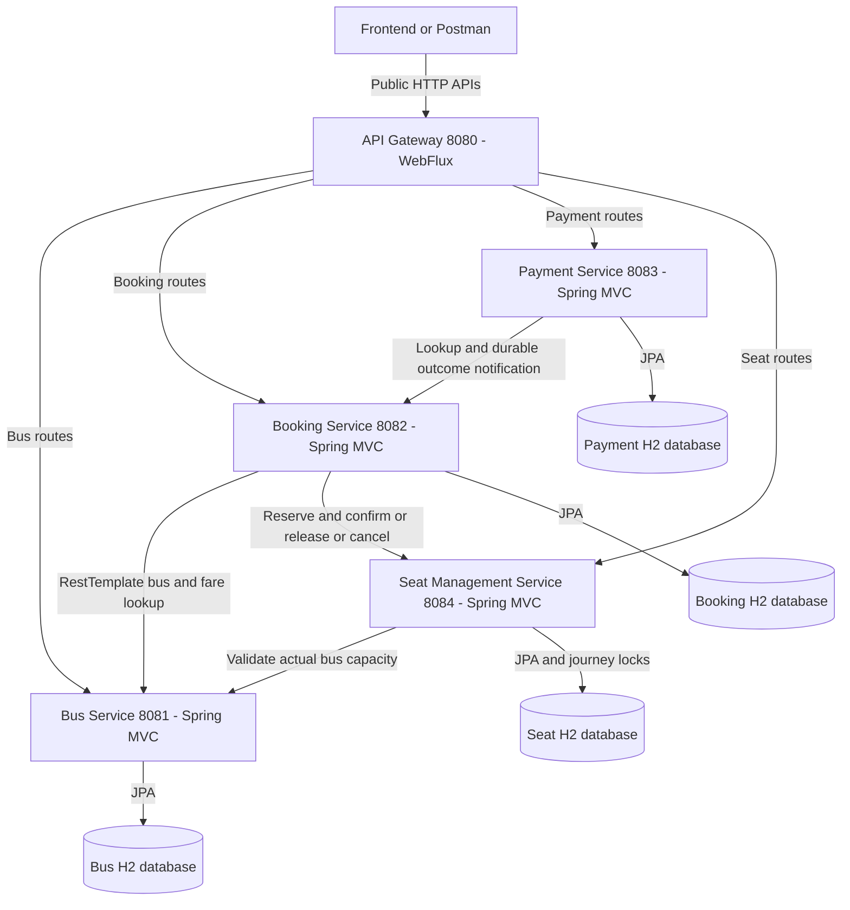
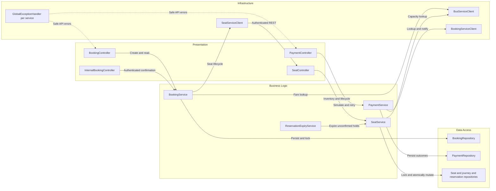

# Architecture Diagram

Five-module Java 17 bus booking system with separate date-specific Seat inventory.
All modules use Spring Boot 3.5.7; no service shares another service's entity or database.

## Application Architecture

<!-- mermaid-checked: no \n, no em-dash/en-dash, no {} in labels, subgraphs are id["label"], arrows are -->|"label"|, all subgraphs closed by end, ids unique -->

### Technology Stack Summary

| Layer | Technology | Version | Purpose |
| --- | --- | --- | --- |
| Runtime | Java | 17 | All applications |
| Framework | Spring Boot | 3.5.7 | Service lifecycle/configuration |
| Gateway | Spring Cloud | 2025.0.0 | Reactive HTTP routing and CORS |
| HTTP | Spring MVC / RestTemplate | Boot-managed | Synchronous business APIs |
| Persistence | JPA / Hibernate | 6.6.33.Final | Separate local repositories |
| Database | H2 | 2.3.232 | Local file DBs and isolated test DBs |
| Documentation | Springdoc | 2.8.13 | Service OpenAPI and Swagger |
| Testing | JUnit 5 / Mockito / MockMvc | Boot-managed | Business/API regression |

### Data Storage & External Services

Each service owns a separate H2 database; the gateway has no database. Bus IDs
and booking IDs are scalar external references. There is no broker, cache,
discovery server, actual banking provider or shared transaction manager.

### Key Architectural Decisions

- Frontend enters through Gateway; internal calls use configurable direct URLs.
- Prices come from the owning service, with BigDecimal calculations and snapshots.
- Successful simulated payment is persisted before idempotent booking notification;
  a failed notification requires retry, not another simulated charge.
- Seat uses an atomic local transaction and pessimistic journey lock for multi-seat
    changes; unique seat keys and a persistent reservation ledger protect retries.
- Unpaid holds expire after 10 minutes. DB-backed recovery workers retry pending
    Booking seat actions and Payment notifications without cross-service transactions.

## Component Relationships

<!-- mermaid-checked: no \n, no em-dash/en-dash, no {} in labels, subgraphs are id["label"], arrows are -->|"label"|, all subgraphs closed by end, ids unique -->

### Component Inventory

| Component | Layer | Type | Responsibility |
| --- | --- | --- | --- |
| BusController / BusService / BusRepository | All Bus layers | REST, business, JPA | Maintain bus details, capacity and fare |
| BookingController | Presentation | REST | Legacy and plural booking APIs |
| InternalBookingController | Presentation | REST | Shared-token confirmation, no gateway route |
| BookingService | Business | Service | Fare calculation, cancellation, confirmation |
| SeatServiceClient | Infrastructure | RestTemplate client | Initialize, reserve, confirm, release and cancel |
| SeatController / SeatService | Seat presentation and business | REST, transactional service | All nine seat APIs and atomic selection |
| JourneyInventoryRepository | Seat data | JPA pessimistic write lock | Serialize a bus/date inventory across DB transactions |
| SeatRepository / ReservationRepository | Seat data | JPA | Unique inventory and durable retry tombstones |
| ReservationExpiryService | Seat business | Scheduled worker | Expire RESERVED only, never BOOKED |
| SeatRecoveryService | Booking business | Scheduled worker | Retry pending actions and cancel abandoned drafts |
| PaymentNotificationRecovery | Payment business | Scheduled worker | Retry durable success/failure notifications |
| BookingRepository | Data | JPA repository | Own database and locked state transitions |
| BusServiceClient | Infrastructure | RestTemplate client | Actual Bus DTO and safe downstream errors |
| PaymentController | Presentation | REST | Payment create, read and notification retry |
| PaymentService | Business | Service | Eligibility, authoritative amount, simulation |
| PaymentRepository | Data | JPA repository | Local payment records only |
| BookingServiceClient | Infrastructure | RestTemplate client | Actual Booking DTO and protected notification |
| RestTemplateConfiguration | Infrastructure | Configuration per service | Bounded connect/read timeouts |
| GlobalExceptionHandler | Presentation | Advice per service | Validation, custom failures, safe error responses |
| GatewayErrorHandler | Infrastructure | Web exception handler | Safe unavailable-service response |
| GatewayRequestLogging | Infrastructure | Global filter | Log method, path and response status |

See the root guide for ordered request/response flow, JSON and recovery semantics.